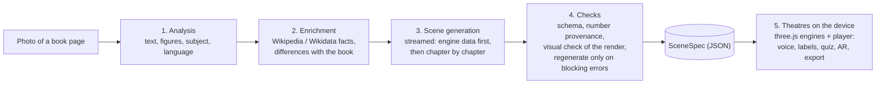

# AnimaPage

**A photo of a page of a study book becomes an animated, interactive 3D lesson in a few minutes.**

**Try it online:** [ten example lessons](https://demartinogiuseppe.github.io/AnimaPage/) · **Prova online:** [dieci lezioni di esempio](https://demartinogiuseppe.github.io/AnimaPage/)

**Using AnimaPage:** [user guide](docs/usage.md) · **Come si usa:** [guida in italiano](docs/guida.md)

<!-- DEMO GIF: docs/media/demo.gif (to be recorded by the owner) -->

You photograph a page of a study book: any subject, any language. The AI does **not** generate images
or video. It reads the page and writes a *declarative scene* (a `SceneSpec`: chapters, narration,
labels, quizzes, camera, data). Hand-built three.js "theatres" then stage that scene on your device,
with facts and numbers checked against sources.

Each lesson has voice narration, labels, quizzes, a **Predict → Try → Explain** activity, AR on Android
(WebXR), the user's own language, and export to a single offline `.html` file or an OpenBoard `.wgt`.

> Status: early stage. It has been tested on only a handful of real book pages. See [Honest limits](#honest-limits).

## How it works



1. **Analysis**: a vision model reads the photo (text, figures, subject, language, audience).
2. **Enrichment**: facts and numbers are looked up in Wikipedia and Wikidata. Where the book and the
   sources disagree, the lesson shows both values instead of silently correcting the book.
3. **Generation**: the model writes the SceneSpec as a stream. The engine data arrives before the
   chapters, so the first chapter can open while the rest is still being written.
4. **Checks**: the SceneSpec is validated (schema, cross-references, every number traced to the page,
   a source or a computation). A visual check renders the scene in a headless browser and compares it
   with the page; the lesson is regenerated only for blocking errors.
5. **Staging**: the theatre for the lesson's subject builds the 3D scene on the device, and the player
   adds narration, labels, quizzes and the activity.

The photo is **not stored** by default (`PAGINAVIVA_STORE_PHOTOS=false`). A saved lesson holds the
generated scene, never the photo. The photo is, however, sent to the AI provider you configure: see
[Legal and privacy](#legal-and-privacy).

### The theatres

Seventeen engines, each a hand-built three.js stage with its own declarative data format:

| Theatre | For |
|---|---|
| `map` | geography: terrain relief, regions, rivers, routes |
| `battle` | battles and military history |
| `timeline` | history timelines |
| `diorama` | stories and everyday scenes (CC0 3D models) |
| `process` | processes (for example the senses, cycles) |
| `concept` | grammar and mathematics concepts (tiles, graphs, formulas) |
| `card` | generic fallback lesson |
| `sky` | astronomy: Moon phases, seasons |
| `lab` | physics experiments (inclined plane, energy) |
| `chart` | data and charts |
| `stage` | dialogues and language lessons |
| `art` | artworks (public-domain images only), perspective |
| `solid` | solid geometry |
| `earth` | Earth sections and earthquakes |
| `music` | notes and the staff |
| `workshop` | simple machines (pulleys, mills) |
| `facade` | architecture, drawn with lines only (five views) |

### Measured numbers

From the project's own runs (live mode, no regeneration needed):

- first chapter on screen after about **1.5 minutes**;
- full lesson after about **3.5 minutes**;
- about **0.75 USD** per lesson at API list price (about 1.25 USD when a regeneration is needed).

## Quick start

Requirements: Node.js 24 or newer and pnpm 9.

```sh
pnpm install
pnpm test           # typecheck + unit tests (offline, no keys needed)
pnpm dev:web        # web app at http://localhost:5173 (ten example lessons are listed under "Esempi"; `PAGINAVIVA_ALL_EXAMPLES=1` lists every scene)
```

To make lessons from your own photos, run the server too (second terminal):

```sh
cp server/.env.example server/.env   # then edit server/.env (git-ignored, never commit it)
pnpm dev:server                      # API at http://127.0.0.1:8787
```

- **Live mode**: set `PAGINAVIVA_MODE=live` in `server/.env`. By default the server calls the
  [Claude Code](https://claude.com/claude-code) CLI, logged in on your machine. Other providers
  (Gemini CLI, local models such as Ollama, OpenAI-compatible endpoints) are listed in
  `server/config/llm_providers.yaml`. Their API keys go **only** in `server/.env`, under the variable
  names in `server/.env.example`.
- **Mock mode** (the default; no network, no keys): the pipeline replays recorded model answers. This is
  what the test suite uses. The public repository does not include the page photos, nor the recordings
  made from protected book pages, so turning your own photo into a lesson needs live mode. Mock mode runs
  the demo scenes and the remaining recordings.
- Phone (HTTPS, camera, WebXR, PWA): `pnpm dev:phone`. Step-by-step guide: [Using AnimaPage on a phone](docs/usage.md#using-animapage-on-a-phone) (italiano: [Usare AnimaPage sul telefono](docs/guida.md#usare-animapage-sul-telefono)); developer notes in [docs/dev-setup.md](docs/dev-setup.md).
- Lesson export: [docs/export.md](docs/export.md).

Repository layout (pnpm monorepo): `apps/web` (Vite app and PWA), `server` (Node/Fastify pipeline),
`packages/scene-spec` (the SceneSpec format and translations), `packages/engine` (player and theatres),
`fixtures` (reference scenes, models, sounds, recorded data), `docs` (decisions, designs), `tools`.
A good first read is [docs/decisions.md](docs/decisions.md).

## How it was built

AnimaPage was built by orchestrating [Claude Code](https://claude.com/claude-code) agents. The owner set
the goals, made the decisions (recorded in `docs/decisions.md`) and reviewed the results; the agents wrote
the code. Work followed subagent-driven development: a written spec and plan per feature, then one task at
a time, each reviewed, with one or two agents running at once. The test suite (over 1,000 tests) acts as
the local CI.

## Honest limits

- Early stage. It has been tested on only about seven real book pages, mostly Italian school material.
  Do not expect it to work on every page.
- It is meant for **a page of a study book**, any subject, any language. It is not a general tool for
  any photo of any text.
- The adult/university ("Academic") style has not been tried on a real university page.
- On a phone, the Predict card covers a large part of the scene.
- Theatre labels have complete tables only for Italian and English; right-to-left scripts are only
  partly supported.
- A lesson is written by an AI model from the page and from public sources. Numbers are checked, but
  mistakes are possible: a teacher should look a lesson over before using it with a class.
- Cost and time depend on the model and provider you choose.
- Every theatre works in live generation. In the public version the prompt examples of the `map`,
  `diorama`, `process` and `concept` (non-maths) theatres are original example lessons written for the
  project (`fixtures/public/scenes/esempio-*.scene.json`: the rivers of Europe, a short invented story,
  the water cycle, the noun), because the reference lessons used during development came from book pages
  and are not published.

**Feedback is very welcome**, especially from teachers, students and publishers: which pages work,
which fail, and what a lesson should do. Please open an issue.

## Security

AnimaPage is a local tool with no user accounts: run it on your own PC and, for the phone, on a network you trust.
`pnpm dev:web` and `pnpm dev:server` listen on localhost only; `pnpm dev:phone` opens the app to your Wi-Fi with a
new access token at every start (open the printed link once on the phone). Do not expose the server to the internet
without your own authentication in front of it. Photos are sent to the AI provider you configured and are not
stored by AnimaPage. Run `pnpm audit --prod` before a release. Details, caps and the threat model:
[docs/security.md](docs/security.md).

## Licence

MIT, Copyright (c) 2026 G. De Martino, see [LICENSE](LICENSE). Third-party assets and data keep their own licences: see [NOTICE.md](NOTICE.md).

### Third-party content

The MIT licence covers AnimaPage's code and the project's own original material only.

- The lessons made from protected book pages during development are **not** in this repository: no page
  photos, no recorded model answers that transcribe them, no lessons generated from them.
- Fully original lessons, written for the project: the four `esempio-*` scenes, the storybook lessons
  (original stories), the façade lessons and the other reference scenes; the `gen-*` lessons were
  generated from synthetic test pages (their page numbers are invented).
- Some reference lessons are built from public sources (Wikipedia, Wikidata, Wikimedia Commons), and a
  few (for example `dati-campania`, `matematica-parabola`) were reconstructed from images, books and notes
  whose copyright remains with their respective authors. Texts are paraphrased, sources are cited in each
  lesson, and no copyrighted page images are included.

Details per lesson and per asset: [NOTICE.md](NOTICE.md). If you hold rights on something here and want
it changed or removed, please open an issue.

## Legal and privacy

AnimaPage is an early-stage tool, shared as is. This is a plain summary, not legal advice.

- **AI-made lessons can be wrong.** A lesson is written by an AI model from the photographed page and from
  public sources. Numbers are checked, but mistakes and misleading wording are still possible. A teacher
  or another adult should review a lesson before using it with a class. Lessons are not professional,
  medical or safety advice.
- **Where the photo goes.** AnimaPage does not store the photo (unless whoever runs the server sets
  `PAGINAVIVA_STORE_PHOTOS=true`). The photo **is** sent to the AI provider chosen in Settings: by default
  the Claude Code CLI logged in on the computer that runs the server (Anthropic), otherwise the Gemini CLI
  (Google), a model running on that computer, or an API you configure. Check that provider's terms and
  privacy policy. Words from the page are sent as text search queries to Wikipedia, Wikidata and
  Wikimedia Commons (and to YouTube, only if a YouTube key is set); map lessons also download open map
  data. Saved lessons and the server's cache keep the text of the page, never the photo, on the computer
  that runs the server. Some browser voices are online voices that send the narration text to their vendor.
- **Do not photograph personal data.** Avoid pages with pupils' names, grades, identifying handwriting or
  faces. AnimaPage has no accounts and no telemetry; it runs on your computer or your local network. A school
  or other organisation that deploys it, especially with minors, is responsible for data protection (in
  the EU, the GDPR), including the choice of AI provider.
- **Rights on the pages.** Photograph only pages you are allowed to use; whether personal or educational use
  of a protected page is allowed depends on your country's law. A lesson made from a protected page
  summarises that page: do not publish or redistribute it (exported `.html`/`.wgt` files included) without
  the rights holder's permission.
- **Third-party services.** The terms of the services you use apply to you: AI providers (including any
  limits on sharing an account or subscription), Wikimedia, and YouTube if you enable it.
- **No affiliation.** AnimaPage is not affiliated with or endorsed by any publisher, Anthropic, Google,
  OpenBoard, Wikimedia or any other company or project named here. Trademarks belong to their owners.
  "AnimaPage" is used as the name of this project; no trademark is claimed.
- **No warranty.** The software is provided "as is", without warranty of any kind (MIT licence, see
  [LICENSE](LICENSE)).

---

## In breve (italiano)

**AnimaPage** trasforma la foto di una pagina di un libro di studio (qualsiasi materia, qualsiasi
lingua) in una lezione 3D animata e interattiva in pochi minuti. L'AI non genera immagini né video: legge
la pagina e scrive una sceneggiatura dichiarativa (SceneSpec); 17 "teatri" three.js fatti a mano la
mettono in scena sul dispositivo. Fatti e numeri sono verificati su Wikipedia e Wikidata; un controllo
visivo rigenera la lezione solo per gli errori bloccanti. Ogni lezione ha voce narrante, etichette, quiz,
l'attività Prevedi → Prova → Dimostra, realtà aumentata su Android ed esportazione offline (`.html` e
widget OpenBoard `.wgt`).

Misure del progetto: primo capitolo dopo circa 1,5 minuti, lezione completa dopo circa 3,5 minuti,
circa 0,75 $ per lezione a prezzo di listino. Le foto non vengono salvate.

Tutti i teatri funzionano nella generazione live. Nella versione pubblica gli esempi per il prompt dei
teatri mappa, diorama, processo e concetti (non matematica) sono lezioni di esempio originali, scritte per
il progetto (i grandi fiumi d'Europa, un breve racconto inventato, il ciclo dell'acqua, il nome): le
lezioni di riferimento usate durante lo sviluppo venivano da pagine di libri e non sono pubblicate.

È in fase iniziale e provato su poche pagine reali. È stato costruito orchestrando agenti Claude Code: le
decisioni sono del proprietario, il codice è scritto dagli agenti, un compito alla volta con revisione.
Cerchiamo riscontri da insegnanti, studenti ed editori. Avvio rapido: `pnpm install`, `pnpm dev:web`;
per le foto proprie vedi `server/.env.example`; per il telefono vedi [Usare AnimaPage sul telefono](docs/guida.md#usare-animapage-sul-telefono). Licenza MIT.

**Sicurezza.** È uno strumento locale, senza account: `pnpm dev:web` e `pnpm dev:server` ascoltano solo sul
PC; `pnpm dev:phone` apre l'app alla rete Wi-Fi con un codice di accesso nuovo a ogni avvio (apri una volta sul
telefono il link stampato nella console). Non esporre il server su internet senza un'autenticazione davanti.
Dettagli in [docs/security.md](docs/security.md).

**Contenuti di terzi.** La licenza MIT copre solo il codice di AnimaPage e il materiale originale del
progetto. Le lezioni nate da pagine di libri protette durante lo sviluppo **non** sono in questo
repository (niente foto delle pagine, niente risposte registrate che le trascrivono, niente lezioni
generate da esse). Sono interamente originali le quattro lezioni `esempio-*`, le lezioni delle storie
(racconti originali), le facciate e le altre scene di riferimento; le lezioni `gen-*` sono generate da
pagine di prova inventate (anche i numeri di pagina sono inventati). Alcune scene di riferimento sono
costruite da fonti pubbliche (Wikipedia, Wikidata, Wikimedia Commons) e alcune (per esempio
`dati-campania`, `matematica-parabola`) sono ricostruite a partire da immagini, libri e appunti i cui
diritti restano ai rispettivi autori: i testi sono parafrasati, le fonti sono citate in ogni lezione e
non sono incluse immagini di pagine protette da copyright. Dettagli in [NOTICE.md](NOTICE.md). Chi
detiene diritti e desidera una modifica o una rimozione può aprire una issue.

**Note legali e privacy.** Riassunto in parole semplici, non è una consulenza legale.

- **Le lezioni fatte dall'AI possono sbagliare.** Sono scritte da un modello AI a partire dalla pagina e
  da fonti pubbliche: i numeri sono controllati, ma restano possibili errori. Un insegnante o un adulto
  dovrebbe rivedere la lezione prima di usarla in classe. Non sono consigli professionali, medici o di
  sicurezza.
- **Dove va la foto.** AnimaPage non salva la foto (a meno che chi gestisce il server imposti
  `PAGINAVIVA_STORE_PHOTOS=true`), ma la foto **viene inviata** al fornitore AI scelto in Impostazioni: di
  base la CLI di Claude Code collegata sul computer che fa da server (Anthropic), oppure la CLI di Gemini
  (Google), un modello sul computer o un'API configurata. Leggi i termini e l'informativa privacy del
  fornitore. Alcune parole della pagina vanno, come ricerche di testo, a Wikipedia, Wikidata e Wikimedia
  Commons (e a YouTube solo se è impostata una chiave YouTube); le lezioni con mappe scaricano dati
  cartografici aperti. Le lezioni salvate e la cache del server conservano il testo della pagina, mai la
  foto. Alcune voci del browser sono voci online che inviano il testo letto al loro fornitore.
- **Non fotografare dati personali.** Evita pagine con nomi, voti, calligrafia riconoscibile o volti degli
  alunni. AnimaPage non ha account né telemetria e gira sul tuo computer o sulla tua rete locale. Se una
  scuola o un altro ente lo installa, soprattutto con minori, è quell'ente a rispondere della protezione
  dei dati (nell'UE il GDPR), compresa la scelta del fornitore AI.
- **Diritti sulle pagine.** Fotografa solo pagine che hai il diritto di usare: se l'uso personale o
  didattico di una pagina protetta sia consentito dipende dalla legge del tuo Paese. Una lezione fatta da
  una pagina protetta ne riassume il contenuto: non pubblicarla né distribuirla (compresi i file `.html` e
  `.wgt` esportati) senza il permesso di chi detiene i diritti.
- **Servizi di terzi.** Valgono per te i termini dei servizi che usi: fornitori AI (compresi eventuali
  limiti alla condivisione di un account o abbonamento), Wikimedia e YouTube se lo attivi.
- **Nessuna affiliazione.** AnimaPage non è affiliato né approvato da alcun editore, da Anthropic, Google,
  OpenBoard, Wikimedia o da altre aziende e progetti citati. I marchi appartengono ai rispettivi titolari.
  "AnimaPage" è il nome del progetto; non si rivendica alcun marchio.
- **Nessuna garanzia.** Il software è fornito "così com'è", senza garanzie di alcun tipo (licenza MIT, vedi
  [LICENSE](LICENSE)).
